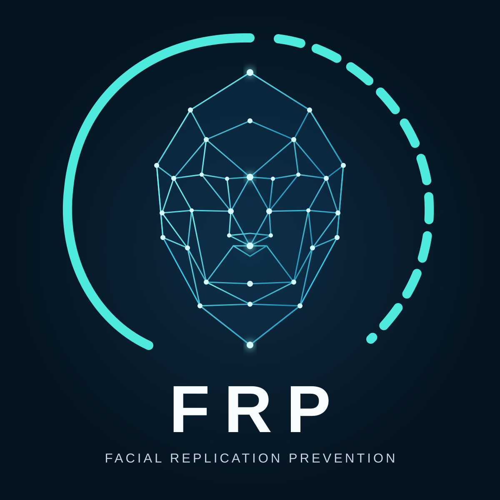

# Facial Replication Prevention

**Researching model-level safeguards against unauthorised replication of real people's facial identities.**

Exploratory, open-source research for generative image and video systems — including locally operated open-weight models.

[Research](#research-library) · [Experiments](#experimental-design) · [Get started](#getting-started) · [Roadmap](ROADMAP.md) · [Contributor guidance](AGENTS.md)

> [!IMPORTANT]
> **Research status: early-stage exploration.** FRP has **not** demonstrated a working facial-replication prevention mechanism. CID is a proposed research direction, not a proven guarantee; the current Python harness performs **planning only**, not model inference or biometric evaluation.

## Why FRP?

Generative systems can preserve a recognisable face when animating or transforming an input portrait. FRP investigates whether models can be made **less capable of unauthorised identity reproduction**, rather than relying only on detecting synthetic media after it has been created.

We study three distinct problems:

| Research question | Focus |
| --- | --- |
| **Can we measure identity retention?** | Calibrated facial similarity, detection coverage, temporal drift and uncertainty |
| **Can we reduce unauthorised replication?** | Conditioning pathways and potential future model-level interventions, without destroying output quality |
| **Can safeguards resist bypass?** | A separate, later question involving model modification, authorisation and deployment controls |

Facial similarity **does not establish consent**. No proposed technique is assumed to make editable model weights tamper-proof.

## Current research focus

FRP's initial experimental target is the official [Wan2.1 image-to-video implementation](https://github.com/Wan-Video/Wan2.1). Our architectural review identifies two image-conditioning routes:

- **CLIP Vision**, contributing image features to transformer attention.
- **Video VAE first-frame conditioning**, supplying the source-frame condition to the denoising latent input.

The proposed **paired 2 × 2 experiment** varies which pathway receives an altered rather than original image condition:

| Variant | CLIP pathway | VAE first-frame pathway |
| :---: | :---: | :---: |
| **A** | Original | Original |
| **B** | Altered | Original |
| **C** | Original | Altered |
| **D** | Altered | Altered |

This is a **diagnostic ablation design**, not a validated privacy safeguard. Reduced similarity is not a successful result if faces disappear or generated video quality is severely impaired. See [Research 004](research/004-conditioning-ablation-design.md) and [Experiment 002](experiments/002-conditioning-ablation-protocol.md).

## Research library

| Document | Purpose |
| --- | --- |
| [Research 001 — Measuring facial identity replication](research/001-identity-replication-measurement.md) | Measurement methodology and uncertainty |
| [Research 002 — CID feasibility and threat model](research/002-cid-feasibility-threat-model.md) | Architectural hypotheses, assumptions and bypass risks |
| [Research 003 — Wan2.1 I2V architecture](research/003-wan21-i2v-architecture.md) | Source-code study of image-conditioning paths |
| [Research 004 — Conditioning ablation design](research/004-conditioning-ablation-design.md) | Controls, comparisons and interpretation |

## Experimental design

| Protocol | Scope |
| --- | --- |
| [Experiment 001 — Baseline identity preservation](experiments/001-baseline-protocol.md) | Establish reproducible measurement before intervention |
| [Experiment 002 — Conditioning pathway ablation](experiments/002-conditioning-ablation-protocol.md) | Test paired A/B/C/D alterations while measuring identity **and** utility |

**No empirical model-mitigation results have been published by FRP.** Research documents and experiment protocols are not evidence that protection works.

## Getting started

The current implementation is a **CPU-only Python planning harness**. It validates versioned experiment manifests and creates deterministic A/B/C/D run plans. It runs **no inference**, downloads **no model weights**, and processes **no portraits or biometric data**.

**Prerequisite:** Python 3.11+. GitHub Codespaces installs dependencies using [the devcontainer configuration](.devcontainer/devcontainer.json). For a local setup:

~~~bash
python -m venv .venv
source .venv/bin/activate
python -m pip install -c constraints.txt -e ".[dev]"

ruff check .
ruff format --check .
pytest

frp plan examples/manifests/synthetic-dry-run.yaml --dry-run
~~~

The synthetic example intentionally has unset execution fields and reports **NOT READY**. For JSON planning output, append the <code>--format json</code> option. To enforce readiness validation, append <code>--require-ready</code>; this only checks manifest fields, **not** consent, licence validity or scientific correctness.

Read [the harness guide](docs/harness.md) for schema requirements, command behaviour, privacy safeguards, exit codes and limitations.

## Project progress

| Phase | Status |
| --- | --- |
| Research foundation and protocol drafting | Documented — not experimentally validated |
| Shared context and contributor guidance | Documented |
| CPU experiment harness | In progress |
| GPU baseline and calibration | Not started |
| Conditioning pathway ablation | Not started |
| Intrinsic model-level mitigation | Hypothesis |
| Robustness and hardening | Future research |

The [roadmap](ROADMAP.md) records milestones, decision gates, and the evidence required before claiming progress.

## Project documentation

- [PROJECT_CONTEXT.md](PROJECT_CONTEXT.md) — mission, hypotheses, boundaries, current evidence and open questions.
- [ROADMAP.md](ROADMAP.md) — milestones, exit criteria and next engineering tasks.
- [AGENTS.md](AGENTS.md) — instructions for human and AI contributors.
- [docs/harness.md](docs/harness.md) — Python harness usage and scientific limitations.

## Research and privacy principles

FRP uses **authorised adult or appropriately licensed data only**. Never commit identifiable source portraits, generated participant videos, biometric embeddings, private consent records, secrets or participant mappings. Keep private material out of issues, CI logs and the public repository.

We document negative results, uncertainty, false positives, utility trade-offs and plausible bypasses. We distinguish **observations**, **hypotheses**, **planned experiments** and **measured outcomes**.

---

FRP is an exploratory research programme, not a released or validated protection product.

