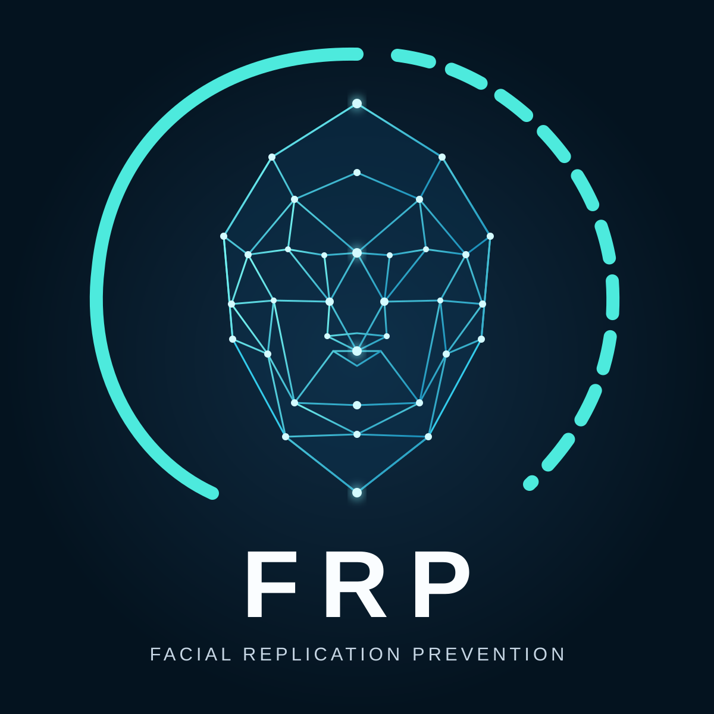

# Facial Replication Prevention

**Researching model-level safeguards against unauthorised replication of real people's facial identities.**

Exploratory, open-source research for generative image and video systems — including locally operated open-weight models.

[Research](#research-library) · [Experiments](#experimental-design) · [Get started](#getting-started) · [Roadmap](ROADMAP.md) · [Contributor guidance](AGENTS.md)

> [!IMPORTANT]
> **Research status: early-stage exploration.** FRP has **not** demonstrated a working facial-replication prevention mechanism. CID is a proposed research direction, not a proven guarantee. The current Python harness performs planning, a **simulated** pipeline on synthetic fixtures, an offline model-provenance check, an offline check of a GPU-readiness *template*, baseline evaluation/aggregation contracts and a local-only private review viewer that this release can open **only** on procedurally generated synthetic content — no model inference and no biometric evaluation. No GPU job, weight download or evaluation of real people has been run.

## Why FRP?

Generative systems can preserve a recognisable face when animating or transforming an input portrait. FRP investigates whether models can be made **less capable of unauthorised identity reproduction**, rather than relying only on detecting synthetic media after it has been created.

We study three distinct problems:

| Research question | Focus |
| --- | --- |
| **Can we measure identity retention?** | Calibrated facial similarity, detection coverage, temporal drift and uncertainty |
| **Can we reduce unauthorised replication?** | Conditioning pathways and potential future model-level interventions, without destroying output quality |
| **Can safeguards resist bypass?** | A separate, later question involving model modification, authorisation and deployment controls |

Facial similarity **does not establish consent**. No proposed technique is assumed to make editable model weights tamper-proof.

## Current research focus

FRP is a **cross-model** research project: the question of unauthorised identity replication applies to many generative image and video systems. Experiments, however, are **model-specific**, because each architecture conditions on images differently and must be verified against pinned source code before a protocol is written.

FRP's first experimental target is the official [Wan2.1 image-to-video implementation](https://github.com/Wan-Video/Wan2.1), pinned at commit `9737cba` with the `Wan-AI/Wan2.1-I2V-14B-480P` checkpoint (see [Research 005](research/005-wan-model-candidates.md)). Our source review of Wan 2.1 identifies two image-conditioning routes:

- **CLIP Vision**, contributing image features to transformer attention.
- **Video VAE first-frame conditioning**, supplying the source-frame condition to the denoising latent input.

The proposed **paired 2 × 2 Wan 2.1 experiment** varies which pathway receives an altered rather than original image condition:

| Variant | CLIP pathway (Wan 2.1) | VAE first-frame pathway (Wan 2.1) |
| :---: | :---: | :---: |
| **A** | Original | Original |
| **B** | Altered | Original |
| **C** | Original | Altered |
| **D** | Altered | Altered |

This is a **diagnostic ablation design**, not a validated privacy safeguard. Reduced similarity is not a successful result if faces disappear or generated video quality is severely impaired. See [Research 004](research/004-conditioning-ablation-design.md) and [Experiment 002](experiments/002-conditioning-ablation-protocol.md).

This A/B/C/D design is specific to Wan 2.1 I2V. A static review of **Wan 2.2 I2V-A14B** at a pinned commit found **no CLIP-vision pathway** (only the VAE first-frame route, split across two denoising experts), so the Wan 2.1 design does not transfer; any Wan 2.2 study needs its own reviewed protocol. Candidate models, provenance and the recommended baseline are documented in [Research 005](research/005-wan-model-candidates.md) and the machine-readable [provenance inventory](provenance/model-candidates.yaml).

## Research library

| Document | Purpose |
| --- | --- |
| [Research 001 — Measuring facial identity replication](research/001-identity-replication-measurement.md) | Measurement methodology and uncertainty |
| [Research 002 — CID feasibility and threat model](research/002-cid-feasibility-threat-model.md) | Architectural hypotheses, assumptions and bypass risks |
| [Research 003 — Wan2.1 I2V architecture](research/003-wan21-i2v-architecture.md) | Source-code study of image-conditioning paths |
| [Research 004 — Conditioning ablation design](research/004-conditioning-ablation-design.md) | Controls, comparisons and interpretation (Wan 2.1 only) |
| [Research 005 — Wan model candidates](research/005-wan-model-candidates.md) | Pinned source verification of Wan 2.1/2.2, candidate inventory and baseline recommendation |

## Experimental design

| Protocol | Scope |
| --- | --- |
| [Experiment 001 — Baseline identity preservation](experiments/001-baseline-protocol.md) | Establish reproducible measurement before intervention |
| [Experiment 002 — Conditioning pathway ablation](experiments/002-conditioning-ablation-protocol.md) | Test paired A/B/C/D alterations while measuring identity **and** utility |
| [Experiment 003 — Wan 2.1 I2V single-condition baseline (design only)](experiments/003-wan21-i2v-baseline-design.md) | Unaltered baseline contract: smoke, calibration and baseline roles; separate from A/B/C/D |

Milestone 004 ([#9](https://github.com/FacialReplicationPrevention/FRP/issues/9)) is the current milestone. Its first PR ([#10](https://github.com/FacialReplicationPrevention/FRP/pull/10), merged) was **preparation only**: a [GPU readiness protocol](docs/gpu-readiness.md) with seven separate human approvals, the baseline design above, and a [private visual-review specification](docs/private-review-viewer.md). Its second ([#11](https://github.com/FacialReplicationPrevention/FRP/pull/11), merged) added CPU-only baseline contracts and a mock-tested, fail-closed executor boundary with the live backend disabled (`frp baseline-plan`, see the [harness guide](docs/harness.md#wan-21-baseline-executor-contracts-milestone-004-pr-2)). PR 3A ([#12](https://github.com/FacialReplicationPrevention/FRP/pull/12), merged) added CPU-only baseline evaluation and descriptive aggregation, and the local-only [private review viewer](docs/private-review-viewer.md) with a synthetic demonstration (`frp review-demo`, `frp review`; see the [harness guide](docs/harness.md#baseline-evaluation-and-private-review-milestone-004-pr-3a)). PR 3B adds a gated, source-mapped adapter for the pinned Wan 2.1 I2V interface behind the same fail-closed executor, tested only against a CPU fake and constructed by no command (see the [gated private-execution runbook](docs/wan21-private-execution-runbook.md)). None of the gates has been approved, and no GPU, weight download, inference or evaluation of real media has run.

**No empirical model-mitigation results have been published by FRP.** Research documents and experiment protocols are not evidence that protection works.

## Getting started

The current implementation is a **CPU-only Python harness**. It validates versioned experiment manifests, creates deterministic Wan 2.1 A/B/C/D run plans, runs a **simulated** execution → evaluation → aggregation → reporting pipeline on deterministic synthetic fixtures, validates the model-candidate provenance inventory offline, and serves a loopback-only review viewer over a synthetic demo store. It runs **no inference**, downloads **no model weights**, and processes **no portraits or biometric data**.

**Prerequisite:** Python 3.11+. GitHub Codespaces installs dependencies using [the devcontainer configuration](.devcontainer/devcontainer.json). For a local setup:

~~~bash
python -m venv .venv
source .venv/bin/activate
python -m pip install -c constraints.txt -e ".[dev]"

ruff check .
ruff format --check .
pytest

frp plan examples/manifests/synthetic-dry-run.yaml --dry-run
frp simulate examples/manifests/synthetic-dry-run.yaml --report-dir runs/simulated-report
frp provenance provenance/model-candidates.yaml
frp readiness readiness/wan21-i2v-baseline.yaml --provenance provenance/model-candidates.yaml
frp baseline-plan examples/manifests/synthetic-baseline-dry-run.yaml

# Synthetic review demo (procedurally generated, non-biometric; outside the repository)
frp review-demo /tmp/frp-review-demo
frp review /tmp/frp-review-demo --mode identity --reviewer RV-01
frp review /tmp/frp-review-demo --mode quality --reviewer RV-02
~~~

The synthetic example intentionally has unset execution fields and reports **NOT READY**. For JSON planning output, append the <code>--format json</code> option. To enforce readiness validation, append <code>--require-ready</code>; this only checks manifest fields, **not** consent, licence validity or scientific correctness.

`frp simulate` writes an aggregate-only `report.md` and `summary.csv`, both marked **SIMULATED DATA — NOT SCIENTIFIC EXPERIMENTAL EVIDENCE**. Select fixture scenarios (failed runs, absent or multiple faces, evaluator errors, missing quality scores, interrupted experiments) with <code>--scenario</code>. Simulated reports test software contracts and missing-data accounting; they say nothing about any model or safeguard.

`frp provenance` checks the model-candidate inventory for internal consistency (pinned evidence for `verified` claims, no invented weight digests, no Wan 2.1 protocol on other architectures). It fetches nothing and does not re-verify upstream sources; every candidate is reported **NOT READY** for execution.

`frp readiness` checks that the public GPU-readiness template is internally consistent and that its pins match the provenance inventory, which must be supplied with `--provenance` (without it the command fails). This is an offline consistency check, not upstream verification. Schema 1.0 can only express **pending** gates and no quote, so a passing check is **never** an approval to download weights, rent a GPU or process anyone's data.

`frp review-demo` writes a store of coloured shapes with fixture "scores", labelled **SIMULATED**. `frp review` serves it on `127.0.0.1` only, behind a per-session token, with outbound network access blocked. A store labelled identifiable is refused: this release ships no access-grant provider, so it cannot open real media anywhere.

Read [the harness guide](docs/harness.md) for schema requirements, adapter interfaces, result and report formats, privacy safeguards, exit codes and limitations.

## Project progress

| Phase | Status |
| --- | --- |
| Research foundation and protocol drafting | Documented — not experimentally validated |
| Shared context and contributor guidance | Documented |
| CPU experiment harness | Milestone 001 (manifest + planner) and Milestone 002 (simulated pipeline) merged |
| Model selection and architecture verification | Milestone 003 merged (pinned source review, provenance inventory); weight hashes, licence-use review and GPU quote still pending |
| GPU baseline and calibration | **Milestone 004 in progress** — PR 1, PR 2 and PR 3A merged (readiness design; CPU-only executor contracts; CPU-only evaluation pipeline and private review viewer, synthetic demo only); PR 3B (gated Wan 2.1 adapter, CPU-fake tests only, unreachable without a private authorisation provider) in review; PR 3C (draft: CPU-only private-storage, immutable-grant and review-posture hardening; authorises nothing); no gate approved, no GPU, download, inference or evaluation of real media run |
| Wan 2.1 conditioning pathway ablation | Not started |
| Intrinsic model-level mitigation | Hypothesis |
| Robustness and hardening | Future research |

The [roadmap](ROADMAP.md) records milestones, decision gates, and the evidence required before claiming progress.

## Project documentation

- [PROJECT_CONTEXT.md](PROJECT_CONTEXT.md) — mission, hypotheses, boundaries, current evidence and open questions.
- [ROADMAP.md](ROADMAP.md) — milestones, exit criteria and next engineering tasks.
- [AGENTS.md](AGENTS.md) — instructions for human and AI contributors.
- [docs/harness.md](docs/harness.md) — Python harness usage, simulated pipeline, provenance and readiness contracts, and scientific limitations.
- [docs/gpu-readiness.md](docs/gpu-readiness.md) — go/no-go gates, cost-quote template, weight acquisition and data-handling procedure (design; nothing approved).
- [docs/gpu-go-no-go-dossier.md](docs/gpu-go-no-go-dossier.md) — planning-only dossier for the seven gates: unverified provider/cost evidence, PR 3C residual risks, a proposed smoke-run spec and no-go conditions (nothing approved).
- [docs/private-review-viewer.md](docs/private-review-viewer.md) — specification and implementation status of the local-only private review viewer (implemented for synthetic content only; no real media reviewed).
- [docs/wan21-private-execution-runbook.md](docs/wan21-private-execution-runbook.md) — Wan 2.1 adapter contract map, pinned upstream call sites, loader-safety assessment and the gated procedure for a future approved smoke test (nothing approved or run).

## Research and privacy principles

FRP uses **authorised adult or appropriately licensed data only**. Never commit identifiable source portraits, generated participant videos, biometric embeddings, private consent records, secrets or participant mappings. Keep private material out of issues, CI logs and the public repository.

We document negative results, uncertainty, false positives, utility trade-offs and plausible bypasses. We distinguish **observations**, **hypotheses**, **planned experiments** and **measured outcomes**.

---

FRP is an exploratory research programme, not a released or validated protection product.

