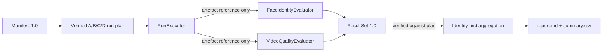

# FRP CPU-only harness — manifest, A/B/C/D planner and simulated pipeline

**Status:** Phase 2. Milestone 001 (manifest schema and dry-run planner,
[issue #1](https://github.com/FacialReplicationPrevention/FRP/issues/1), merged in
[PR #2](https://github.com/FacialReplicationPrevention/FRP/pull/2)) and Milestone 002
(simulated execution, evaluation and reporting,
[issue #5](https://github.com/FacialReplicationPrevention/FRP/issues/5), under review).

**No real inference or measurement.** The harness loads no model, runs no inference, reads no
images, computes no embeddings and has **measured no scientific outcome**. A valid manifest,
run plan or simulated report is not evidence that any conditioning alteration protects
identity. Simulated reports test software contracts only.

**Model scope.** FRP's research mission covers multiple generative model families, but the
fixed A/B/C/D mapping, run plan, result protocol id (`wan2.1-i2v-clip-vae-2x2`) and simulated
executor model family (`wan2.1-i2v`) model the **Wan 2.1 I2V** CLIP/VAE ablation hypothesis
only. Nothing here implies support for Wan 2.2 or any other model; another model family needs
its own source-verified, reviewed protocol.

## What it does

1. Parses a YAML (or JSON) experiment manifest and validates it against schema version `1.0`.
2. Generates a deterministic, paired run plan for the 2 × 2 design in
   [Experiment 002](../experiments/002-conditioning-ablation-protocol.md).
3. Verifies pairing invariants and prints a privacy-safe summary (`frp plan … --dry-run`).
4. Runs the plan through **simulated** executor and evaluator adapters, validates the result
   records against the plan, aggregates them identity-first and writes aggregate-only
   Markdown/CSV reports (`frp simulate …`).

| Module | Responsibility |
| --- | --- |
| [`frp.variants`](../src/frp/variants.py) | Fixed A/B/C/D → (CLIP source, VAE first-frame source) mapping |
| [`frp.manifest`](../src/frp/manifest.py) | Schema, YAML loading, readiness check, content hashes |
| [`frp.planner`](../src/frp/planner.py) | Run-plan generation and invariant verification |
| [`frp.interfaces`](../src/frp/interfaces.py) | Executor, face/identity evaluator and video-quality evaluator contracts |
| [`frp.results`](../src/frp/results.py) | Result schema `1.0`, null rules, plan linkage checks |
| [`frp.pipeline`](../src/frp/pipeline.py) | Orchestrator: plan → adapters → validated result records |
| [`frp.simulation`](../src/frp/simulation.py) | Deterministic synthetic executor/evaluators and scenarios |
| [`frp.aggregation`](../src/frp/aggregation.py) | Frame → clip → identity → variant summaries and paired contrasts |
| [`frp.reporting`](../src/frp/reporting.py) | Aggregate-only Markdown and CSV reports (report schema `1.0`) |
| [`frp.cli`](../src/frp/cli.py) | `frp plan MANIFEST --dry-run`, `frp simulate MANIFEST --report-dir DIR` |

## Reproducible local commands

In a clean CPU Codespace (Python 3.11+; no GPU, network model downloads or personal data):

~~~bash
python -m pip install -c constraints.txt -e ".[dev]"
ruff check .
ruff format --check .
pytest -q
frp plan examples/manifests/synthetic-dry-run.yaml --dry-run
frp simulate examples/manifests/synthetic-dry-run.yaml --report-dir runs/simulated-report
~~~

`runs/` is git-ignored. `frp simulate` refuses to replace existing report files unless
`--overwrite` is passed, and its output is byte-for-byte reproducible for the same manifest,
scenario and `frp` version.

## Manifest schema 1.0

See the synthetic example in
[`examples/manifests/synthetic-dry-run.yaml`](../examples/manifests/synthetic-dry-run.yaml).

### Planning inputs (required, non-empty)

| Field | Rules |
| --- | --- |
| `schema_version` | Must be the string `"1.0"` (quote it in YAML) |
| `experiment_id` | Upper-case letters, digits and `-` |
| `status` | Must be `planned` |
| `variants` | Each of `A`, `B`, `C`, `D` exactly once; listing order does not affect the plan |
| `identities` | `[{pseudonym: SYN-001}, …]`; format `^[A-Z]{2,8}-[0-9]{3,8}$`; unique; no other keys |
| `prompts` | `[{id, text}, …]`; unique ids and unique texts |
| `seeds` | Unique integers in `[0, 2**32 - 1]`; booleans, floats and strings are rejected |

### Execution fields (may be `null` while planning)

All other fields from the Experiment 002 example manifest are **required keys**. While planning
they may be `null`, which is the *only* accepted "explicitly unset" marker. Placeholder text
such as `TODO`, `TBD`, `<fill me>`, `{{ x }}`, `???` or `N/A` is rejected so that unset values
cannot be mistaken for real ones. `frp plan … --dry-run` lists every unset field;
`--require-ready` exits with code 3 until all are set and `model_license_reviewed` is `true`.
Readiness is a **presence and format check only**: it does not verify consent, licence
validity, that hashes match real files, or that the selected values are scientifically
appropriate.

Format checks applied when a value is set: `upstream_commit_sha` is a 40-hex Git SHA;
`checkpoint_hashes` maps file names to 64-hex SHA-256 digests; `frame_count` has the form
4n+1; `frame_indices` are strictly increasing and below `frame_count`; `resolution` uses
Wan's `W*H` form (e.g. `832*480`); `number_of_identities`, if set, equals the identity count.

Fixed values: `consent_record_location: private_only` and `image_count_per_identity: 1`.

### Strictness

Unknown keys, duplicate YAML keys, custom YAML tags, multi-document files, type coercion
(e.g. `"42"` for a seed), non-finite floats (`.inf`, `.nan`) and non-mapping documents are
rejected. Exponent-form numbers such as `1e-05` (as written by JSON serialisers) load as floats,
not strings. Validation errors report the schema path, rule and YAML line/column but never echo
input values: user-supplied mapping keys are shown as `<key>`, and YAML parser messages are
replaced by fixed descriptions.

## How A/B/C/D pairing is guaranteed

- A **trial group** is one `(identity, prompt, seed)` tuple. Groups are the Cartesian product
  identities × prompts × seeds, in manifest order, numbered from 1.
- Each group contains exactly four runs in the fixed order A, B, C, D. The conditioning for
  each variant comes from the immutable protocol table in `frp.variants`, not from the manifest.
- Every run in a group carries the same identity, prompt id, seed and
  `generation_controls_sha256` (a hash of model revision, checkpoint, alteration and sampling
  settings). Only `clip_conditioning` and `vae_first_frame_conditioning` vary.
- `generate_run_plan` always calls `verify_run_plan`, which re-checks these invariants plus:
  every run id equals `make_run_id(experiment_id, group_index, variant)` (so a unique but
  wrong or swapped id is rejected), unique run ids, unique tuples, consecutive numbering and,
  when the manifest is supplied, matching experiment id and exact, index-consistent coverage
  of the manifest product. Tests tamper with plans to confirm each violation is detected.

## Privacy of CLI output

- Identity pseudonyms are replaced by ordinal labels (`identity-01`) unless
  `--show-pseudonyms` is passed; keep such output private, as Experiment 002 treats
  pseudonyms as non-public.
- Prompt ids are user-controlled and could accidentally contain personal information, so
  they are replaced by ordinal labels (`prompt-01`, in manifest order) unless
  `--show-prompt-ids` is passed for private debugging.
- Prompt text, file paths, image references and embeddings are never printed. The manifest is
  identified by a SHA-256 content hash.
- Run ids (`<experiment_id>-G0001-A`) contain no pseudonym, prompt text or seed.

Exit codes: `0` success, `1` invalid manifest/plan (or, for `simulate`, invalid results),
`2` usage error (including omitting `--dry-run` for `plan`), `3` not ready (only with
`--require-ready`), `4` report files could not be written (including existing files without
`--overwrite`).

## Simulated pipeline (Milestone 002)

`frp simulate MANIFEST --report-dir DIR [--scenario NAME] [--overwrite]` runs:

In this milestone every adapter is a deterministic **simulation**; no real adapter exists.

### Adapter interfaces (`frp.interfaces`)

Structural `typing.Protocol` contracts with no ML, imaging or GPU imports. Each adapter exposes
an `info` record (name, revision, simulated flag) that is copied into the results.

| Contract | Input | Output | Notes |
| --- | --- | --- | --- |
| `RunExecutor` | `PlannedRun` | `ExecutionRecord` (`succeeded` + artefact reference, or `failed` + failure category) | Wan 2.1 A/B/C/D specific because it consumes the Wan 2.1 plan; `not_executed` is set only by the orchestrator |
| `FaceIdentityEvaluator` | artefact reference, identity pseudonym, frame indices | one `FrameEvaluation` per frame, in order | Not told the variant. Detection status is separate from similarity |
| `VideoQualityEvaluator` | artefact reference only | `QualityEvaluation` | Blind to variant and identity; unscorable output is a status, never an invented score |

The orchestrator (`frp.pipeline.execute_plan`) verifies the plan, executes runs in plan order
and assigns exactly one result record per planned run. Adapter exceptions become `failed` runs
(`executor_error`) or `error` evaluations **without** their messages, which could contain
paths or private data. Adapter contract violations (wrong frame list, executor claiming
`not_executed`) raise `ResultValidationError`. `max_runs` simulates an interrupted experiment:
the remaining runs are recorded as `not_executed`, not dropped.

### Result schema 1.0 (`frp.results`)

Result records are **private structured records**: they hold run ids, group, variant,
conditioning, seed and *ordinal* identity/prompt indices, plus artefact references — but never
pseudonyms, prompt text, media or embeddings. Persisting them to private storage is future work;
`parse_result_set_json` validates a serialised `ResultSet`.

| Level | Rules |
| --- | --- |
| `FrameEvaluation` | `face_status` ∈ `valid`, `absent`, `multiple`, `low_quality`, `error`, `not_evaluated`. `similarity` is a finite number in [-1, 1] **only** when `valid`, otherwise `null` (never `0`) |
| `QualityEvaluation` | `status` ∈ `scored`, `unscorable`, `error`, `not_evaluated`; `score` only when `scored`, and within the evaluator's declared scale |
| `ExecutionRecord` | `succeeded` requires an artefact reference (URI form, so a bare file path is rejected); `failed` requires a `failure_category` (fixed vocabulary, no free text); `not_executed` has no runtime. `gpu_seconds` is optional |
| `RunResult` | Conditioning must match the protocol table for its variant; run id must match group and variant; a run that did not succeed must have every frame and quality `not_evaluated` |
| `ResultSet` | `result_schema_version: "1.0"`, `protocol: wan2.1-i2v-clip-vae-2x2` (executor `model_family` must be `wan2.1-i2v`), plan hashes, declared `frame_indices` and their source, adapter info. Every group has exactly one A, B, C and D record with identical identity, prompt and seed. Duplicate run ids are rejected. Any simulated component forces `simulated: true` and a `simulation_scenario` |

`verify_results_against_plan(results, plan, manifest)` additionally rejects missing, orphaned,
duplicate or mismatched records and hash mismatches. With a manifest, frame indices must equal
the manifest's when it sets them; for **non-simulated** results the manifest must set them and
the evaluator revisions must equal `face_evaluator_revision` and `quality_rubric_version`.
Strictness matches the manifest: unknown keys, type coercion and non-finite numbers are
rejected, and errors never echo input values or unknown key names.

### Simulation scenarios (`frp.simulation`)

All values are synthetic fixtures. Outcomes follow fixed modular rules over (group index,
variant position, frame position); valid-face "similarities" are SHA-256-derived numbers in
[0.1, 0.9] and quality "scores" are integers on a simulated 1–5 rubric. Fixture values do **not**
depend on the variant's conditioning, so any between-variant difference is an artefact.
`gpu_seconds` is left `null` rather than inventing a hardware cost. If the manifest leaves
`frame_indices` unset, the Experiment 002 candidate set `0, 20, 40, 60, 80` is used and
recorded as `simulation_default`.

| Scenario | Exercises |
| --- | --- |
| `mixed` (default) | Failed runs, an interrupted tail (`not_executed`), every face status and every quality status |
| `all-valid` | Every run succeeds and every value is present |
| `absent-face` | Frames with no detectable face |
| `multiple-faces` | Ambiguous frames with more than one face |
| `evaluator-error` | Face and quality evaluator errors |
| `missing-quality` | Unavailable (`not_evaluated`) and `unscorable` quality |
| `failed-run` | Runs that fail to execute |
| `incomplete` | Experiment interrupted after 75% of planned runs |

### Aggregation (`frp.aggregation`)

Frames within a clip and clips within an identity are **not** independent observations.

1. **Clip:** face-status counts; later-frame similarity = median over `valid` frames with
   index ≠ 0, available only if at least `min_valid_later_frames` (default 1) exist;
   first-frame (index 0) similarity reported separately.
2. **Identity × variant:** median of available clip values.
3. **Variant:** median across identities, with the number of contributing identities.
   Detection coverage, execution and quality status counts are reported as descriptive totals
   with explicit denominators.
4. **Paired contrasts** B − A, C − A, D − A (later-frame similarity and quality): differences
   are formed only within a trial group where both values exist, summarised per identity
   (median), then as a median across identities. Incomplete groups are counted by cause
   (baseline missing, variant missing, both); nothing is imputed. A contrast with no complete
   identity is reported as insufficient.

No calibration, thresholds, confidence intervals or tests are computed. `UncertaintyEstimator`
is the extension point for a future identity-clustered method: it receives one unlabelled value
per identity and returns an interval or `None`.

### Reports (report schema 1.0, `frp.reporting`)

- `report.md` — banner, provenance (hashes, schema versions, adapter revisions, frame indices),
  execution outcomes, detection coverage, similarity, quality, paired contrasts and
  interpretation constraints.
- `summary.csv` — long format with columns `data_provenance, report_schema_version,
  experiment_id, section, subject, metric, value, value_status`. Every row's
  `data_provenance` is `SIMULATED DATA — NOT SCIENTIFIC EXPERIMENTAL EVIDENCE`. Missing values
  are an empty `value` with `value_status` `not_available` (or `not_computed` for intervals).

Reports are aggregate-only: they never contain pseudonyms or ordinal identity labels, prompt ids
or text, seeds, run ids, artefact references, file paths, media or embeddings, and the CLI does
not print the report directory. Adversarial tests plant marker strings in pseudonyms, prompt
ids, prompt text, seeds and the report path and check that none appear. **Only simulated results
can be reported:** `render_markdown`/`render_csv` raise `ReportError` for non-simulated results
until a privacy review defines disclosure rules (e.g. small-cell suppression).

### Example synthetic output

> SIMULATED DATA — NOT SCIENTIFIC EXPERIMENTAL EVIDENCE. The numbers below come from fixture
> rules and describe no model, person or safeguard.

~~~text
$ frp simulate examples/manifests/synthetic-dry-run.yaml --report-dir runs/simulated-report
SIMULATED DATA — NOT SCIENTIFIC EXPERIMENTAL EVIDENCE
Synthetic fixtures only: no model, image, video, face or embedding was used.

Experiment:  FRP-EXP-002-SYNTHETIC-EXAMPLE (scenario mixed)
Planned runs: 24  Simulated successes: 17  Trial groups: 6
Wrote report.md and summary.csv to the report directory.
~~~

Excerpt of the generated `report.md`:

~~~markdown
## Run execution outcomes

| Variant | CLIP | VAE first frame | Planned | Succeeded | Failed | Not executed |
| --- | --- | --- | --- | --- | --- | --- |
| A | original | original | 6 | 5 | 1 | 0 |
| B | altered | original | 6 | 4 | 1 | 1 |
| C | original | altered | 6 | 4 | 1 | 1 |
| D | altered | altered | 6 | 4 | 1 | 1 |

## Paired comparisons (identity level, no imputation)

| Contrast | Metric | Median identity difference | Identities with pair | Complete groups | Missing A only | Missing variant only | Missing both | Status |
| --- | --- | --- | --- | --- | --- | --- | --- | --- |
| B - A | Later-frame similarity | +0.065 | 2 / 3 | 3 / 6 | 1 | 2 | 0 | incomplete pairs excluded (not imputed) |
~~~

### Milestone 002 decisions for review

These are implementation choices, not protocol changes.

1. **Later frames** are all declared frame indices except `0`; Experiment 002's candidate
   primary set (`20, 40, 60, 80`) follows from this when frame indices are `0, 20, 40, 60, 80`.
2. **`min_valid_later_frames` defaults to 1.** Experiment 002 does not specify a minimum; the
   value should be fixed in the analysis plan before real data.
3. **Primary contrasts are B − A, C − A, D − A** as listed in Experiment 002. The B/C/D
   interaction is not summarised.
4. **Medians at each level** (clip, identity, variant) as a robust descriptive summary; the
   analysis plan may choose otherwise.
5. **Detection coverage totals pool frames** as descriptive counts with explicit denominators,
   alongside identity-level availability; they are not treated as independent observations.
6. **The face evaluator receives the identity pseudonym** (to locate a private reference
   image) but not the variant; the quality evaluator receives only an artefact reference.
   Blinding codes for human raters are still to be designed.
7. **Real-data public reports are disabled** until a privacy review defines disclosure rules.

## Departures from Experiment 002 and decisions for review

These are implementation choices, not protocol changes. Each needs scientific review.

1. **Additional planning fields.** `schema_version`, `variants`, `identities` and `prompts`
   are added; Experiment 002's example has `seeds: null`, but schema 1.0 requires concrete
   seeds because a paired plan cannot be built without them.
2. **Run ids are deterministic ordinals, not random.** Experiment 002 describes `run_id` as a
   "random non-identifying ID". Ordinal ids keep planning reproducible. Because they contain
   the variant letter, they **must not** be shown to blinded quality raters; separate
   blinding codes are still to be designed.
3. **Full crossing.** Every identity is planned with every prompt and seed. Per-identity seed
   or prompt subsets are not supported.
4. **One reference image per identity** (`image_count_per_identity` fixed at `1`), matching the
   pilot description.
5. **Seed range** `[0, 2**32 - 1]`. Negative seeds are rejected because upstream Wan2.1
   replaces `seed < 0` with a random seed (`wan/image2video.py`, observed at upstream `main`
   commit `9737cba`; re-check at the pinned revision). The upper bound is a conservative
   FRP portability choice, not an upstream limit.
6. **`frame_count` must be 4n+1**, following the `--frame_num` help text in upstream
   `generate.py` (same commit, to be re-checked at the pinned revision).
7. **Negative-prompt text is not a separate field.** Research 004 requires identical
   positive/negative prompts across A–D; schema 1.0 relies on `prompt_template_version` for
   this. A dedicated field may be warranted.

## Known limitations

- No real inference, image transform, face detection, identity evaluation or video-quality
  scoring is implemented. Only simulated adapters exist; their outputs are fixtures.
- Simulated reports validate software contracts and denominators, not scientific outcomes.
  Fixture similarity/quality values do not resemble real recogniser or rubric distributions.
- No calibration, match thresholds, uncertainty intervals, interaction analysis or
  inferential statistics are implemented.
- Result records are validated in memory and via `parse_result_set_json`; there is no private
  storage integration, retention policy or CLI for persisting/reloading records.
- Equality of generation controls is guaranteed by construction from a single manifest; the
  harness cannot yet verify that a future executor actually applies them.
- With few identities, aggregate medians can approximate individual values. Real-data public
  reporting is therefore disabled pending a privacy review.
- The pseudonym pattern is a format guard, not proof that a value is non-identifying.
- `--require-ready` checks presence and format, not correctness of hashes, licences or consent.
- The executor contract and result protocol are Wan 2.1 A/B/C/D specific; other model
  families need their own reviewed protocol.
- Dependency lower bounds in `pyproject.toml` are untested; only `constraints.txt` pins are
  tested in CI.

## Dependency versioning strategy

`pyproject.toml` declares compatible ranges for runtime (`pydantic`, `PyYAML`) and development
(`pytest`, `ruff`) dependencies. [`constraints.txt`](../constraints.txt) pins the exact tested
set, including transitive packages, and is used by the devcontainer and CI. Update pins
deliberately in a dedicated change and re-run lint and tests. No ML, CUDA or model packages
are dependencies.
